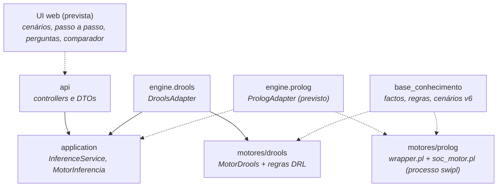

# CyberRangers — Backend e motores de inferência


-85EA2D?logo=swagger&logoColor=black)


Analista virtual de SOC: recebe a telemetria de um cenário (alertas, eventos de hosts, logins, tráfego) e
recomenda incidentes, tickets e perguntas ao analista, aplicando a mesma base de conhecimento (v6, 92 regras) em
dois motores de inferência, **SWI-Prolog** e **Drools**, para os poder comparar. Um backend Spring Boot expõe os
dois atrás do mesmo contrato JSON.

Serve a demonstração e a avaliação do Desafio 1: correr cenários passo a passo, responder às perguntas do motor,
ver como cada conclusão foi obtida e confrontar o resultado dos dois motores. Os motores só recomendam; não
executam contenção nem abrem tickets em sistemas externos.

---

## Table of contents

- [Estado do projeto](#estado-do-projeto)
- [Tech stack](#tech-stack)
- [Arquitetura](#arquitetura)
- [Como funciona um pedido](#como-funciona-um-pedido)
- [Solution layout](#solution-layout)
- [Módulos](#módulos)
- [Getting started](#getting-started)
- [Testing](#testing)
- [Documentation map](#documentation-map)
- [Contributing](#contributing)

---

## Estado do projeto

O repositório está na fase de montagem da arquitetura. A tabela separa o que existe do que está previsto, para
ninguém assumir uma peça que ainda não corre.

| Peça | Estado |
| :--- | :--- |
| Build Maven multi-módulo (`pom.xml` na raiz) | Feito; `.\mvnw.cmd verify` passa |
| Módulo `motores/drools` com `MotorDrools` | Feito, com uma regra de exemplo; as 92 regras reais por portar |
| Backend: `MotorInferencia` e `DroolsAdapter` | Feito; sem endpoints REST ainda |
| Base de conhecimento v6 (`base_conhecimento/`) | Feito: factos, 92 regras, 67 ficheiros de cenário e `soc_cenarios.pl` |
| Motor Prolog (`soc_motor.pl`) | Feito: corre a v6; resultados de referência em `motores/prolog/referencia_prolog/` |
| `wrapper.pl` (`motores/prolog/`) | Feito: pedido e resposta JSON, passos, erros (issue #9) |
| `PrologAdapter` | Por fazer |
| Controllers, validação do pedido, UI, comparador | Por fazer |
| Scripts de geração (`gera_meta.pl`, `gera_json.pl`) | Por fazer |

---

## Tech stack

| Concern | Choice | Notes |
| :--- | :--- | :--- |
| Runtime | **Java 25**, `java.version` em [`backend/cyber/pom.xml`](backend/cyber/pom.xml) | O módulo Drools compila com `release 17`; corre em JDK 25 |
| Framework | **Spring Boot 4.1.1** (`spring-boot-starter-web`) | Só o backend usa Spring |
| Build | **Maven 3.10.0** via Maven Wrapper na raiz | Wrapper em [`.mvn/wrapper/`](.mvn/wrapper/) |
| Motor de regras | **Drools 10.1.0** (`drools-engine`, `drools-mvel`, `drools-xml-support`) | Corre dentro da JVM do backend |
| Motor Prolog | **SWI-Prolog 10.0.2** | Versão em uso no desenvolvimento, ainda não fixada; corre como processo externo |
| JSON | **Jackson 2.18.2** no módulo Drools | O backend usa o Jackson do Spring Boot |
| API docs | **springdoc-openapi 3.1.1** | Dependência declarada; sem endpoints para documentar ainda |
| Tests | **JUnit 5** (`junit-jupiter` 5.11.4 no módulo Drools, `spring-boot-starter-test` no backend) | Surefire 3.5.2 no módulo Drools |

---

## Arquitetura

Dois motores independentes respondem ao **mesmo pedido** com o **mesmo formato de resposta**, e é isso que
permite compará-los. O backend só conhece a interface `MotorInferencia` e o contrato JSON; nenhum motor conhece
o backend, e as regras e os factos vivem fora do Java.



Linhas contínuas são dependências que já existem no código; tracejadas são as previstas.

| Camada | Responsabilidade | Path |
| :--- | :--- | :--- |
| **api** | Controllers REST e DTOs do contrato; sem lógica de inferência | `backend/cyber/src/main/java/cyberrangers/cyber/api/` |
| **application** | Valida o pedido, escolhe o motor; define `MotorInferencia` | `backend/cyber/src/main/java/cyberrangers/cyber/application/` |
| **domain** | `Facto`, `Passo`, `Resultado`; sem Spring nem motores | `backend/cyber/src/main/java/cyberrangers/cyber/domain/` |
| **engine** | Adaptadores `drools` e `prolog` que implementam `MotorInferencia` | `backend/cyber/src/main/java/cyberrangers/cyber/engine/` |
| **config** | Propriedades tipadas e beans | `backend/cyber/src/main/java/cyberrangers/cyber/config/` |
| **Motor Drools** | Módulo Maven sem Spring: regras DRL e `MotorDrools` | `motores/drools/` |
| **Motor Prolog** | Motor, wrapper JSON, ferramentas e resultados de referência | `motores/prolog/` |
| **Base de conhecimento** | Fonte única de factos, regras e cenários | `base_conhecimento/` |

Princípios que o código tem de respeitar:

- **Servidor sem estado** — cada pedido traz tudo o que aconteceu até ao momento e o motor infere de novo, numa
  sessão ou processo novos. Não há sessões guardadas entre pedidos.
- **Dois motores, um contrato** — o `MotorDrools` já recebe e devolve JSON; o `wrapper.pl` usa o mesmo formato
  em `stdin`/`stdout`. Os adaptadores do backend ficam por isso quase iguais.
- **Uma só fonte para o conhecimento** — factos fixos e cenários escrevem-se em `base_conhecimento/` e geram-se
  para os outros formatos. Só as regras existem duas vezes (Prolog e DRL), escritas à mão.
- **Os motores só recomendam** — não executam ações nem integram produtos SOC.

> **Porque o Prolog fica fora do Maven e o Drools não:** o Drools é uma biblioteca da JVM e entra no backend como
> dependência; o Prolog é um processo `swipl` com ciclo de vida próprio, que também se corre à mão, sem Java.

---

## Como funciona um pedido

O pedido é uma **lista ordenada de passos**. Um passo é a telemetria de um cenário ou uma resposta do analista.
Para cada passo o motor injeta os factos, corre até não haver conclusões novas e passa ao seguinte.

```json
{
  "versaoKB": "6",
  "passos": [
    {"id": "cenario_07", "factos": [
      {"predicado": "alerta_ids", "args": ["ev_e1", "web_srv_04", "sig_apache_path_traversal"]}
    ]},
    {"id": "resposta_1", "factos": [
      {"predicado": "resposta_analista", "args": ["web_srv_04", "ev_e1", "shell_servico", "sim"]}
    ]}
  ]
}
```

- **A ordem conta.** A pergunta ao analista só aparece se a resposta ainda não existir; carregar tudo de uma vez
  daria um resultado diferente do de uma corrida seguida.
- **Perguntas são factos.** O motor nunca pára à espera de ninguém: uma regra conclui `pergunta_analista/3` e a
  resposta entra como um passo novo com `resposta_analista/4`.
- **Recuar é enviar menos passos**; mudar uma resposta é reenviar a lista com outro valor.
- **A resposta** traz `estado` (`concluido`, `aguarda_resposta` ou `erro`), `perguntas`, `incidentes`, `tickets`
  e a lista completa de `factos`, cada um deduzido com a regra e as premissas que o concluíram — daí sai o
  "Como?" sem trabalho extra.
- **Versão desconhecida** (`versaoKB` diferente da carregada) devolve `estado: "erro"`, nunca uma inferência com
  outra versão.

A comparação entre motores faz-se pelo conteúdo dos factos, nunca pelos números nem pela ordem de disparo.

---

## Solution layout

```
.
├── pom.xml                       agregador Maven: motores/drools e backend/cyber
├── mvnw, mvnw.cmd, .mvn/         Maven Wrapper (Maven 3.10.0), partilhado por todos os módulos
├── base_conhecimento/            fonte única da base v6: soc_factos/regras/suporte.txt, cenarios/
├── motores/
│   ├── drools/                   módulo Maven sem Spring: MotorDrools, regras DRL, kmodule.xml, testes
│   └── prolog/                   motor SWI-Prolog, wrapper, ferramentas, referencia_prolog/
├── backend/cyber/
│   ├── pom.xml                   Spring Boot 4.1.1; depende de motores-drools
│   └── src/main/
│       ├── java/cyberrangers/cyber/{api,application,domain,engine,config}
│       └── resources/{generated,static}   JSON gerado e UI web
├── docs/                         documentação e decisões de arquitetura
└── .gitignore                    ignora IDE, target/ e ficheiros locais
```

Cada pasta tem um `README.md` com o seu papel.

---

## Módulos

O código organiza-se por **motor**: cada motor é um projeto com os seus testes e as suas regras, e o backend
limita-se a adaptadores. Há quatro blocos.

- **`motores/drools`** — `MotorDrools.infere(String)` abre uma `KieSession` nova por pedido, insere os factos de
  cada passo, corre `fireAllRules()` e faz `dispose()` no fim. As regras estão em
  `src/main/resources/regras/` (hoje só `00_exemplo.drl`) e são carregadas por `META-INF/kmodule.xml`.
- **`motores/prolog`** — o núcleo (`soc_motor.pl`) faz encadeamento direto com metaconhecimento, todas as
  instanciações e ponto fixo. O `wrapper.pl` lê o pedido do `stdin` e escreve um único documento JSON no
  `stdout`.
- **`base_conhecimento`** — 314 factos fixos, 92 regras e 67 ficheiros de cenário (39 cenários numerados, com variantes e
  respostas do analista); é o que os dois motores têm de reproduzir de forma igual.
- **`backend/cyber`** — `CyberApplication` e os pacotes da tabela de arquitetura; hoje contém a interface
  `MotorInferencia` e o `DroolsAdapter`.

> **Motor Prolog e base v6.** A v6 pede ao motor que reavalie uma regra quando chega um facto lido por uma
> condição calculada (`condicao_le/2`, em `soc_suporte.txt`). O `soc_motor.pl` chega ao mesmo resultado porque
> repete as passagens por todos os factos até não haver conclusões novas: nas 10 variantes de
> `motores/prolog/referencia_prolog/` dá os mesmos factos que uma versão que segue o requisito à letra.

---

## Getting started

### Prerequisites

| Tool | Why | Notes |
| :--- | :--- | :--- |
| **JDK 25** | Compilar e correr o backend | `JAVA_HOME` tem de apontar para ele; um JDK mais antigo falha com a versão do `pom.xml` |
| **Ligação à internet** | O Maven Wrapper descarrega o Maven 3.10.0 e as dependências | Só na primeira execução |
| **SWI-Prolog 10.x** | Correr o motor Prolog à mão e, mais tarde, o `PrologAdapter` | *Opcional* hoje: o backend e o módulo Drools não o usam |

### Build e testes

Tudo a partir da raiz do repositório, no PowerShell:

```powershell
# Confirma que o JDK em uso é o 25
java -version

# Compila e testa os dois módulos
.\mvnw.cmd verify
```

### Run it

O módulo Drools tem de estar instalado no repositório local antes de arrancar o backend por si só:

```powershell
# Instala motores-drools no repositório Maven local
.\mvnw.cmd -pl motores/drools install -DskipTests

# Arranca o backend
.\mvnw.cmd -pl backend/cyber spring-boot:run
```

| Surface | URL |
| :--- | :--- |
| Backend | `http://localhost:8080` — arranca, mas ainda não expõe endpoints |

### Troubleshooting

| Symptom | Cause and fix |
| :--- | :--- |
| `No plugin found for prefix 'spring-boot' in the current project` | O comando foi corrido na raiz com `-am`, e o módulo Drools não declara o plugin. Instala o módulo Drools e corre com `-pl backend/cyber` como acima. |
| `Failed to delete ...\motores\drools\target\classes\...` no `clean` | Um processo (IDE ou Java ainda vivo) tem ficheiros de `target/` abertos. Fecha-o e repete, ou corre `verify` sem `clean`. |

---

## Testing

```powershell
# Toda a suite (os dois módulos)
.\mvnw.cmd verify

# Só o módulo Drools
.\mvnw.cmd -pl motores/drools test
```

| Suite | Path | Expectation |
| :--- | :--- | :--- |
| `MotorDroolsTest` | `motores/drools/src/test/java/cyberrangers/motores/drools/` | A regra de exemplo dispara; `versaoKB` desconhecida devolve `estado: "erro"` |
| `DroolsAdapterTest` | `backend/cyber/src/test/java/cyberrangers/cyber/engine/drools/` | O adaptador chama o `MotorDrools` e devolve a conclusão |
| `CyberApplicationTests` | `backend/cyber/src/test/java/cyberrangers/cyber/` | O contexto Spring arranca com o Drools carregado |

Naming: `<Classe>Test.java` para testes unitários e `<Classe>Tests.java` no teste de contexto do Spring.

Não há pipeline de CI configurada; os testes correm só localmente.

---

## Documentation map

| Document | What it covers |
| :--- | :--- |
| [`motores/README.md`](motores/README.md) | Um projeto por motor e como cada um corre |
| [`motores/drools/README.md`](motores/drools/README.md) | Módulo Drools: contrato, regras e testes |
| [`motores/prolog/README.md`](motores/prolog/README.md) | Lado Prolog: núcleo, menu, wrapper e regras do wrapper |
| [`base_conhecimento/README.md`](base_conhecimento/README.md) | A base v6 e as regras de a manter |
| [`backend/cyber/src/main/java/cyberrangers/cyber/engine/prolog/README.md`](backend/cyber/src/main/java/cyberrangers/cyber/engine/prolog/README.md) | Critérios que o `PrologAdapter` tem de cumprir (processo, UTF-8, timeout) |
| [`docs/README.md`](docs/README.md) | Documentação e decisões de arquitetura previstas |

---

## Contributing

### Branching — GitFlow

| Branch type | Pattern | Created from | Targets |
| :--- | :--- | :--- | :--- |
| Feature | `feature/<nome>` (ex.: `feature/motor-prolog`) | `develop` | `develop` |
| Integração | `develop` | — | `main` |
| Estável | `main` | — | — |

- `develop` é a linha de integração; `main` recebe só o que está estável.
- Uma feature sem os últimos commits de `develop` faz rebase antes do merge.

### Workflow

1. Cria `feature/<nome>` a partir de `develop`.
2. Faz commits no formato Conventional Commits (`feat:`, `refactor:`, `docs(motores):`, `test(motores):`).
3. Corre `.\mvnw.cmd verify` antes de abrir o PR.
4. Abre o PR para `develop`.

> Mudar regras da base implica regenerar o metaconhecimento Prolog e atualizar o DRL; o comparador é o que
> garante que os dois dizem o mesmo.
