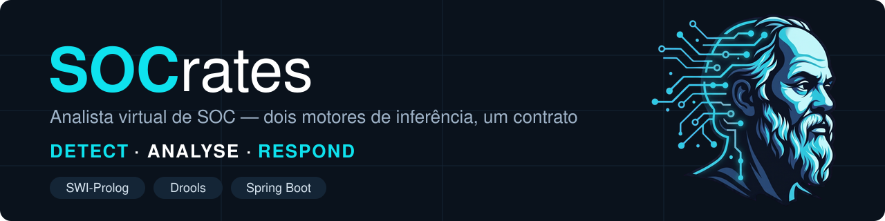
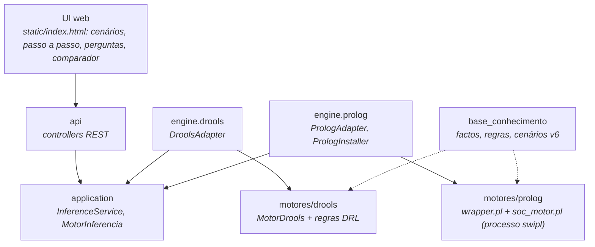

# SOCrates — Backend e motores de inferência


-85EA2D?logo=swagger&logoColor=black)


Analista virtual de SOC: recebe a telemetria de um cenário (alertas, eventos de hosts, logins, tráfego) e recomenda incidentes, tickets e perguntas ao analista, aplicando a mesma base de conhecimento (v6, 92 regras) em dois motores de inferência, **SWI-Prolog** e **Drools**, para os poder comparar. Um backend Spring Boot expõe os dois atrás do mesmo contrato JSON.

Serve a demonstração e a avaliação do Desafio 1: correr cenários passo a passo, responder às perguntas do motor, ver como cada conclusão foi obtida e confrontar o resultado dos dois motores. Os motores só recomendam; não executam contenção nem abrem tickets em sistemas externos.

---

## Table of contents

- [Estado do projeto](#estado-do-projeto)
- [Tech stack](#tech-stack)
- [Arquitetura](#arquitetura)
- [Como funciona um pedido](#como-funciona-um-pedido)
- [Explicações](#explicações)
- [Solution layout](#solution-layout)
- [Módulos](#módulos)
- [Getting started](#getting-started)
- [Testing](#testing)
- [Documentation map](#documentation-map)
- [Contributing](#contributing)

---

## Estado do projeto

A tabela separa o que existe do que está previsto, para ninguém assumir uma peça que ainda não corre.

| Peça | Estado |
| :--- | :--- |
| Build Maven multi-módulo (`pom.xml` na raiz) | Feito; `.\mvnw.cmd verify` corre os dois módulos |
| Base de conhecimento v6.1 (`base_conhecimento/`) | Feito: 390 factos fixos, 107 regras, 57 cenários e `soc_cenarios.pl` |
| Motor Prolog (`soc_motor.pl`) e `wrapper.pl` | Feito: corre a v6; resultados de referência em `motores/prolog/referencia_prolog/`; o wrapper recebe e devolve JSON (issue #9) |
| Módulo `motores/drools` com `MotorDrools` | Feito: as 107 regras (grupos A a O) e as condições calculadas, factos numerados, justificação por facto, resposta no formato do `wrapper.pl`, estado "pronto". As regras A a G e N dão o mesmo que o Prolog nas 10 variantes de cenários; as diferenças conhecidas nas regras H a M estão em [`docs/changes/features/F0002-drools-regras-a-g-n/PENDENTES_H_M.md`](docs/changes/features/F0002-drools-regras-a-g-n/PENDENTES_H_M.md) |
| Consola dos motores | Feito: o Drools tem o menu do Prolog (opções 0 a 13, os mesmos textos) com "como?", "porque não?" e o "porque?" das perguntas ao analista |
| Backend: adaptadores `DroolsAdapter` e `PrologAdapter` | Feito: o `PrologAdapter` lança o `wrapper.pl` num processo `swipl` por pedido, com timeout, limite de processos e cópia dos ficheiros Prolog dentro do jar (`PrologInstaller`, issue #11) |
| Backend: API REST | Feito: `/api/{motor}/infer`, `/como`, `/porque`, `/porque-pergunta`, `/api/cenarios` e `/api/health`, com Swagger UI. Falta o `whynot` (depende do "porque não?" estruturado no Prolog) |
| Scripts de geração | Feito: `gera_json.pl` gera `factos_iniciais.json` e `cenarios.json` (issue #10); `gera_meta.pl --verificar` diz se o metaconhecimento está em dia (AC13) |
| UI web e comparador de motores | Feito (PR #39): `backend/socrates/src/main/resources/static/index.html`, servida pelo backend em `/` — cenários passo a passo, incidentes, tickets, perguntas e respostas, o "Como?" e o comparador dos dois motores. A paridade pela API, sem o UI, corre com `ferramentas/paridade.py` (#16) |

---

## Tech stack

| Concern | Choice | Notes |
| :--- | :--- | :--- |
| Runtime | **Java 25**, `java.version` em [`backend/socrates/pom.xml`](backend/socrates/pom.xml) | O módulo Drools compila com `release 17`; corre em JDK 25 |
| Framework | **Spring Boot 4.1.1** (`spring-boot-starter-web`) | Só o backend usa Spring |
| Build | **Maven 3.10.0** via Maven Wrapper na raiz | Wrapper em [`.mvn/wrapper/`](.mvn/wrapper/) |
| Motor de regras | **Drools 10.1.0** (`drools-engine`, `drools-mvel`, `drools-xml-support`) | Corre dentro da JVM do backend |
| Motor Prolog | **SWI-Prolog 10.0.2** | Versão em uso no desenvolvimento, ainda não fixada; corre como processo externo |
| JSON | **Jackson 2.18.2** no módulo Drools | O backend usa o Jackson do Spring Boot |
| API docs | **springdoc-openapi 3.1.1** | Swagger UI e OpenAPI do backend |
| UI | **HTML/JS estático** (`index.html`), servido pelo backend | Sem build; os testes do UI usam Playwright (`testes/ui/`) |
| Tests | **JUnit 5** (`junit-jupiter` 5.11.4 no módulo Drools, `spring-boot-starter-test` no backend) | Surefire 3.5.2 no módulo Drools |

---

## Arquitetura

Dois motores independentes respondem ao **mesmo pedido** com o **mesmo formato de resposta**, e é isso que permite compará-los. O backend só conhece a interface `MotorInferencia` e o contrato JSON; nenhum motor conhece o backend, e as regras e os factos vivem fora do Java.



Linhas contínuas são dependências no código ou chamadas à API; tracejadas são ficheiros que o motor lê em vez de importar.

| Camada | Responsabilidade | Path |
| :--- | :--- | :--- |
| **api** | Controllers REST; o corpo do pedido e da resposta é o JSON do contrato, passado como texto | `backend/socrates/src/main/java/socrates/backend/api/` |
| **application** | Valida o pedido, escolhe o motor; define `MotorInferencia` e `Explicador` | `backend/socrates/src/main/java/socrates/backend/application/` |
| **domain** | `Facto`, `Passo`, `Pedido`, `Resultado`; sem Spring nem motores | `backend/socrates/src/main/java/socrates/backend/domain/` |
| **engine** | Adaptadores `drools` e `prolog` que implementam `MotorInferencia` | `backend/socrates/src/main/java/socrates/backend/engine/` |
| **config** | Propriedades tipadas e beans | `backend/socrates/src/main/java/socrates/backend/config/` |
| **Motor Drools** | Módulo Maven sem Spring: regras DRL, `MotorDrools` e consola | `motores/drools/` |
| **Motor Prolog** | Motor, wrapper JSON, ferramentas e resultados de referência | `motores/prolog/` |
| **Base de conhecimento** | Fonte única de factos, regras e cenários | `base_conhecimento/` |

Princípios que o código tem de respeitar:

- **Servidor sem estado** — cada pedido traz tudo o que aconteceu até ao momento e o motor infere de novo, numa sessão ou processo novos. Não há sessões guardadas entre pedidos.
- **Dois motores, um contrato** — o `MotorDrools` recebe e devolve JSON; o `wrapper.pl` usa o mesmo formato em `stdin`/`stdout`. Os adaptadores do backend ficam por isso quase iguais.
- **Uma só fonte para o conhecimento** — factos fixos e cenários escrevem-se em `base_conhecimento/` e geram-se para os outros formatos. Só as regras existem duas vezes (Prolog e DRL), escritas à mão.
- **Os motores só recomendam** — não executam ações nem integram produtos SOC.

> **Porque o Prolog fica fora do Maven e o Drools não:** o Drools é uma biblioteca da JVM e entra no backend como dependência; o Prolog é um processo `swipl` com ciclo de vida próprio, que também se corre à mão, sem Java.

---

## Como funciona um pedido

O pedido é uma **lista ordenada de passos**. Um passo é a telemetria de um cenário ou uma resposta do analista. Para cada passo o motor injeta os factos, corre até não haver conclusões novas e passa ao seguinte.

```json
{
  "versaoKB": "6",
  "passos": [
    {"id": "cenario_07", "factos": [
      {"predicado": "alerta_ids", "args": ["ev_e1", "web_srv_04", "sig_apache_path_traversal"]}
    ]},
    {"id": "resposta_1", "factos": [
      {"predicado": "resposta_analista", "args": ["web_srv_04", "ev_e1", "shell_servico", "sim"]}
    ]}
  ]
}
```

- **A ordem conta.** A pergunta ao analista só aparece se a resposta ainda não existir; carregar tudo de uma vez daria um resultado diferente do de uma corrida seguida.
- **Perguntas são factos.** O motor nunca pára à espera de ninguém: uma regra conclui `pergunta_analista/3` e a resposta entra como um passo novo com `resposta_analista/4`.
- **Recuar é enviar menos passos**; mudar uma resposta é reenviar a lista com outro valor.
- **A resposta** traz `estado` (`concluido`, `aguarda_resposta` ou `erro`), `perguntas`, `incidentes`, `tickets` e a lista completa de `factos`, cada um deduzido com a regra e as premissas que o concluíram — daí sai o "Como?" sem trabalho extra.
- **Versão desconhecida** (`versaoKB` diferente da carregada) devolve `estado: "erro"`, nunca uma inferência com outra versão.

A comparação entre motores faz-se pelo conteúdo dos factos, nunca pelos números nem pela ordem de disparo.

---

## Explicações

Os dois motores explicam as suas conclusões. Cada tipo responde a uma pergunta diferente, e a API só expõe os que fazem sentido para o que lhe é pedido.

| Explicação | Responde a | Onde |
| :--- | :--- | :--- |
| **Como?** | Como se chegou a uma conclusão: a árvore de factos e regras, até aos dados de entrada | Opção 9 da consola; `POST /api/{motor}/como` |
| **Porque não?** | Porque uma conclusão não existe: para cada regra que a podia dar, o que falta e porquê | Opção 10 da consola; `MotorDrools.porqueNao` (o endpoint `whynot` ainda não existe) |
| **Porque?** | Porque o sistema faz uma pergunta ao analista: a regra que a gerou e as regras que usam a resposta | Escrever `porque` ao responder a uma pergunta (opção 5 da consola); `POST /api/{motor}/porque-pergunta` |

O endpoint `POST /api/{motor}/porque` devolve a árvore de um facto com a regra completa em cada nó (`regraCompleta`). É um "como?" com as regras escritas, e não o "porque?" de uma pergunta.

---

## Solution layout

```
.
├── pom.xml                       agregador Maven: motores/drools e backend/socrates
├── mvnw, mvnw.cmd, .mvn/         Maven Wrapper (Maven 3.10.0), partilhado por todos os módulos
├── base_conhecimento/            fonte única da base v6.1: soc_factos/regras/suporte.txt, cenarios/
├── motores/
│   ├── drools/                   módulo Maven sem Spring: MotorDrools, regras DRL, consola, kmodule.xml, testes
│   └── prolog/                   motor SWI-Prolog, wrapper, ferramentas, referencia_prolog/, testes/
├── backend/socrates/
│   ├── pom.xml                   Spring Boot 4.1.1; depende de motores-drools
│   └── src/main/
│       ├── java/socrates/backend/{api,application,domain,engine,config}
│       └── resources/{generated,static}   JSON gerado e UI web (index.html)
├── ferramentas/                  paridade.py: compara os dois motores pela API (#16)
├── testes/ui/                    testes do UI com Playwright (correr.js, verificacoes.js)
├── docs/                         registo das features em docs/changes/features/
├── assets/                       banner deste README (com o logo do Desafio 1)
└── .github/workflows/            CI: backend.yml, drools.yml, prolog.yml
```

Cada pasta de código tem um `README.md` com o seu papel.

---

## Módulos

O código organiza-se por **motor**: cada motor é um projeto com os seus testes e as suas regras, e o backend limita-se a adaptadores. Há cinco blocos.

- **`motores/drools`** — `MotorDrools.infere(String)` abre uma `KieSession` nova por pedido, insere os factos iniciais e corre as regras sobre eles, depois insere os factos de cada passo, corre `fireAllRules()` e faz `dispose()` no fim. A resposta tem o formato do `wrapper.pl`, com justificação por facto. As regras estão em `src/main/resources/regras/` (um `.drl` por grupo, de `A_afetado.drl` a `N_catalogo.drl`) e são carregadas por `META-INF/kmodule.xml`. O módulo traz também as explicações (`como`, `porque`, `porqueNao`, `porquePergunta`) e a `ConsolaDrools`.
- **`ferramentas` e `testes/ui`** — `paridade.py` envia o mesmo pedido aos dois motores e compara as respostas pelo conteúdo; `testes/ui/` verifica que o UI mostra exatamente o que o motor devolve (nós e setas do grafo, tickets, perguntas, "Como?").
- **`motores/prolog`** — o núcleo (`soc_motor.pl`) faz encadeamento direto com metaconhecimento, todas as instanciações e ponto fixo. O `wrapper.pl` lê o pedido do `stdin` e escreve um único documento JSON no `stdout`.
- **`base_conhecimento`** — 390 factos fixos, 107 regras e 57 cenários; é o que os dois motores têm de reproduzir de forma igual.
- **`backend/socrates`** — `SocratesApplication` e os pacotes da tabela de arquitetura: os controllers, o `InferenceService`, a interface `MotorInferencia`, o `DroolsAdapter`, o `PrologAdapter` (um processo `swipl` por pedido, configurado por `socrates.prolog.*` em `PrologProperties`) e o `PrologInstaller`. Sem `socrates.prolog.home`, o `PrologInstaller` copia o `wrapper.pl`, o `soc_motor.pl` e a `base_conhecimento/` que o Maven pôs no jar (`prolog-dist/`) para uma pasta temporária, apagada quando a aplicação termina; com ele, usa essa pasta (por exemplo, a raiz do repositório).

> **Motor Prolog e base v6.** A v6 pede ao motor que reavalie uma regra quando chega um facto lido por uma condição calculada (`condicao_le/2`, em `soc_suporte.txt`). O `soc_motor.pl` faz essa reavaliação; os resultados das 14 variantes estão em `motores/prolog/referencia_prolog/`.

---

## Getting started

### Prerequisites

| Tool | Why | Notes |
| :--- | :--- | :--- |
| **JDK 25** | Compilar e correr o backend | `JAVA_HOME` tem de apontar para ele; um JDK mais antigo falha com a versão do `pom.xml` |
| **Ligação à internet** | O Maven Wrapper descarrega o Maven 3.10.0 e as dependências | Só na primeira execução |
| **SWI-Prolog 10.x** | O `PrologAdapter` lança o `swipl`; também corre o motor Prolog à mão | Tem de estar no `PATH`, ou indicado em `socrates.prolog.swipl`; os testes do backend precisam dele |

### Build e testes

Tudo a partir da raiz do repositório, no PowerShell:

```powershell
# Confirma que o JDK em uso é o 25
java -version

# Compila e testa os dois módulos
.\mvnw.cmd verify
```

### Run it

O módulo Drools tem de estar instalado no repositório local antes de arrancar o backend por si só:

```powershell
# Instala motores-drools no repositório Maven local
.\mvnw.cmd -pl motores/drools install -DskipTests

# Arranca o backend
.\mvnw.cmd -pl backend/socrates spring-boot:run
```

| Surface | URL |
| :--- | :--- |
| Backend e UI web | `http://localhost:8080` |
| Swagger UI | `http://localhost:8080/swagger-ui/index.html` |
| OpenAPI (JSON) | `http://localhost:8080/v3/api-docs` |
| Estado dos motores | `http://localhost:8080/api/health` |
| Catálogo de cenários | `http://localhost:8080/api/cenarios` |

O UI usa a API do próprio backend, por isso basta abrir `http://localhost:8080/`. Na Swagger UI, os `POST /api/{motor}/...` pedem o motor (`drools` ou `prolog`) e um corpo com `versaoKB` e `passos`. Um passo pronto a enviar de cada cenário está em `backend/socrates/src/main/resources/generated/cenarios.json`.

Cada motor também corre sozinho, sem o backend, de duas formas:

| Modo | Drools | Prolog |
| :--- | :--- | :--- |
| **Interativo** (o mesmo menu nos dois: cenários, factos, perguntas ao analista, incidentes, "como?", "porque não?") | No IntelliJ, *Run* na `ConsolaDrools`; ou `.\mvnw.cmd -q -pl motores/drools compile exec:java "-Dexec.args=--interativo"` | Na raiz: `swipl motores/prolog/soc_motor.pl`, depois `?- menu.`, opção `1.` e o ficheiro `'base_conhecimento/soc_factos.txt'.` (entre plicas e com ponto final; o exemplo do menu, `'../../...'`, só serve se o `swipl` arrancar dentro de `motores/prolog/`) |
| **Um pedido** (JSON no `stdin`, resposta no `stdout`) | `Get-Content pedido.json \| .\mvnw.cmd -q -pl motores/drools compile exec:java` | `Get-Content pedido.json \| swipl motores/prolog/wrapper.pl base_conhecimento` |

A consola do Drools tem o menu do Prolog (opções 0 a 13, os mesmos textos e a mesma numeração). Os factos escrevem-se `nome(arg, arg)`, sem sintaxe Prolog, e a consola arranca com a base já carregada (regras, `factos_iniciais.json`, `cenarios.json` e `regras.json` vêm no módulo). Detalhes e exemplo de pedido em [`motores/drools/README.md`](motores/drools/README.md#correr-só-o-drools).

### Troubleshooting

| Symptom | Cause and fix |
| :--- | :--- |
| `Web server failed to start. Port 8080 was already in use.` | Há outro processo na porta 8080, por exemplo uma execução anterior do backend no IntelliJ. Pára-o, ou arranca noutra porta: `.\mvnw.cmd -pl backend/socrates spring-boot:run "-Dspring-boot.run.arguments=--server.port=8081"`. |
| `No plugin found for prefix 'spring-boot' in the current project` | O comando foi corrido na raiz com `-am`, e o módulo Drools não declara o plugin. Instala o módulo Drools e corre com `-pl backend/socrates` como acima. |
| `Failed to delete ...\motores\drools\target\classes\...` no `clean` | Um processo (IDE ou Java ainda vivo) tem ficheiros de `target/` abertos. Fecha-o e repete, ou corre `verify` sem `clean`. |
| `erroComAspasEBarrasContinuaAserJsonValido` falha no Windows com `InvalidPath` | O teste cria uma pasta com aspas no nome, que o Windows não aceita; passa em Linux, onde corre a CI. |

---

## Testing

```powershell
# Toda a suite (os dois módulos)
.\mvnw.cmd verify

# Só o módulo Drools
.\mvnw.cmd -pl motores/drools test

# Só o backend (compila também o módulo Drools; precisa do SWI-Prolog no PATH)
.\mvnw.cmd -pl backend/socrates -am verify

# Lado Prolog: wrapper e JSON gerados (precisa do SWI-Prolog)
swipl -g run_tests -t halt motores/prolog/testes/testes.pl

# Com o backend a correr em localhost:8080: paridade Prolog x Drools pela API (precisa de Python 3)
python3 ferramentas/paridade.py

# Com o backend a correr em localhost:8080: o UI mostra o que o motor devolve (precisa de Node)
npm install playwright && npx playwright install chromium   # uma vez
node testes/ui/correr.js
```

| Suite | Path | Expectation |
| :--- | :--- | :--- |
| `MotorDroolsTest` | `motores/drools/src/test/java/socrates/motores/drools/` | Factos, perguntas, tickets, estado "pronto" e erros do pedido como no `wrapper.pl` |
| `ParidadeTest` | `motores/drools/src/test/java/socrates/motores/drools/` | Paridade com o Prolog nas 14 variantes de cenários (AC14/AC15): as 107 regras contra `motores/prolog/referencia_prolog/` (diferenças H–M listadas) |
| `MotorDroolsExplicacoesTest` | `motores/drools/src/test/java/socrates/motores/drools/` | `como`, `porque`, `porquePergunta` e os erros do pedido na API do motor |
| `TermosJsonTest`, `RespostaTest` | `motores/drools/src/test/java/socrates/motores/drools/json/` | Termos JSON ↔ Java; premissas no formato do wrapper, com os nomes das variáveis |
| `BaseFactosTest`, `CondicoesCalculadasTest` | `motores/drools/src/test/java/socrates/motores/drools/sessao/` | Numeração, origem, passo, factos repetidos e marcas; os resultados da `origem_evidencia` |
| `ConsolaDroolsTest`, `TermoTextoTest` | `motores/drools/src/test/java/socrates/motores/drools/consola/` | A consola com entradas escritas no teste: menu 0 a 13, cenários, perguntas com "porque", factos sem sintaxe Prolog, "como?", "porque não?", recuperação, pedido de um ficheiro |
| `PorqueNaoTest`, `UnificacaoTest`, `PorqueNaoRegraTest` | `motores/drools/src/test/java/socrates/motores/drools/consola/`, `.../explicacao/` | O "porque não?" igual, linha a linha, ao `whynot/1` do Prolog em 10 factos (formato Prolog, só para o teste); unificação e condições calculadas com variáveis por ligar; a regra completa nos dados do "porque não?" |
| `InferControllerTest`, `ExplicacaoControllerTest`, `SystemControllerTest` | `backend/socrates/src/test/java/socrates/backend/api/` | A camada HTTP com o `InferenceService` simulado: cada caminho chama o método certo e devolve o código do `HttpResponseUtils`; `/api/cenarios` e `/api/health` |
| `InferenceServiceTest`, `RequestValidatorTest`, `BaseCarregadaTest` | `backend/socrates/src/test/java/socrates/backend/application/` | Escolha do motor pelo nome, pedido inválido ou de outra `versaoKB` que nunca chega ao motor, erros da validação com a posição do passo, e a leitura da versão e dos cenários |
| `PedidoJsonTest`, `SaudeMotorTest` | `backend/socrates/src/test/java/socrates/backend/domain/` | Leitura do pedido do contrato (chaves a mais ignoradas, a menos a `null`) e o estado de saúde de cada motor |
| `DroolsAdapterTest` | `backend/socrates/src/test/java/socrates/backend/engine/drools/` | O adaptador chama o `MotorDrools` e devolve a conclusão da R7 |
| `SocratesApplicationTests` | `backend/socrates/src/test/java/socrates/backend/` | O contexto Spring arranca com o Drools carregado e o `PrologInstaller` copia os ficheiros Prolog |
| `PrologPropertiesTest` | `backend/socrates/src/test/java/socrates/backend/config/` | Valores de omissão de `socrates.prolog.*`, nomes do YAML e recusa de valores inválidos |
| `PrologAdapterTest` | `backend/socrates/src/test/java/socrates/backend/engine/prolog/` | AC1–AC7 do #11 com o `swipl` real: resposta normal, cópia do jar sem `home` (AC6), acentos (AC2), resposta acima do buffer do pipe (AC4), timeout sem processos vivos (AC5), "ocupado" (AC7), erros do motor e executável em falta; `wrapper.pl` falsos numa pasta temporária provocam as falhas |
| `verificacoes.js`, `correr.js` | `testes/ui/` | O UI mostra exatamente o que o motor devolve: nós e setas do grafo, tickets, perguntas, o "Como?" de cada ticket e as vistas por cenário; sai com 1 se algo falhar |
| `paridade.py` | `ferramentas/` | Os dois motores dão os mesmos incidentes, tickets e perguntas (AC14) e as mesmas conclusões com a mesma regra e premissas (AC15); sai com 0, 1 ou 2 |
| `testes.pl` (plunit) | `motores/prolog/testes/` | O wrapper cumpre os AC2, AC3, AC10–AC12 e M9; os JSON gerados (AC18) e as referências do motor estão em dia |

Naming: `<Classe>Test.java` para testes unitários e `<Classe>Tests.java` no teste de contexto do Spring.

CI: em cada PR e em cada push para `develop` e `main` correm três GitHub Actions:

| Workflow | O que corre |
| :--- | :--- |
| `.github/workflows/prolog.yml` | Os testes Prolog (`motores/prolog/testes/testes.pl`) |
| `.github/workflows/drools.yml` | O módulo Drools: `./mvnw -B -pl motores/drools verify`, com o JDK 25 |
| `.github/workflows/backend.yml` | O backend: `./mvnw -B -pl backend/socrates -am verify`, com o JDK 25 e o SWI-Prolog |

---

## Documentation map

| Document | What it covers |
| :--- | :--- |
| [`ferramentas/README.md`](ferramentas/README.md) | `paridade.py`: a paridade Prolog × Drools pela API |
| [`testes/ui/README.md`](testes/ui/README.md) | Os testes do UI e o que cada verificação cobre |
| [`motores/README.md`](motores/README.md) | Um projeto por motor e como cada um corre |
| [`motores/drools/README.md`](motores/drools/README.md) | Módulo Drools: contrato, regras, consola e testes |
| [`motores/prolog/README.md`](motores/prolog/README.md) | Lado Prolog: núcleo, menu, wrapper e regras do wrapper |
| [`base_conhecimento/README.md`](base_conhecimento/README.md) | A base v6.1 e as regras de a manter |
| [`backend/socrates/src/main/java/socrates/backend/api/README.md`](backend/socrates/src/main/java/socrates/backend/api/README.md) | Os controllers, os endpoints e os códigos HTTP |
| [`backend/socrates/src/main/java/socrates/backend/engine/prolog/README.md`](backend/socrates/src/main/java/socrates/backend/engine/prolog/README.md) | Critérios que o `PrologAdapter` tem de cumprir (processo, UTF-8, timeout) |
| [`docs/changes/features/README.md`](docs/changes/features/README.md) | O registo das features F0001 a F0007: o plano e o resultado de cada uma |
| [`docs/README.md`](docs/README.md) | Documentação do projeto |

---

## Contributing

### Branching — GitFlow

| Branch type | Pattern | Created from | Targets |
| :--- | :--- | :--- | :--- |
| Feature | `feature/<nome>` (ex.: `feature/drools-menu-why`) | `develop` | `develop` |
| Integração | `develop` | — | `main` |
| Estável | `main` | — | — |

- `develop` é a linha de integração; `main` recebe só o que está estável.
- Uma feature sem os últimos commits de `develop` faz rebase antes do merge.

### Workflow

1. Cria `feature/<nome>` a partir de `develop`.
2. Faz commits no formato Conventional Commits (`feat(drools):`, `fix(backend):`, `docs(motores):`, `test(motores):`), com `Refs: #<issue>` quando houver issue.
3. Regista a feature em `docs/changes/features/F<NNNN>-<nome>/` (`README.md` com o plano e `RESULT.md` com o resultado) e acrescenta-a à tabela de [`docs/changes/features/README.md`](docs/changes/features/README.md).
4. Corre `.\mvnw.cmd verify` antes de abrir o PR.
5. Abre o PR para `develop`.

> Mudar regras da base implica regenerar o metaconhecimento Prolog e atualizar o DRL; o comparador é o que garante que os dois dizem o mesmo.
